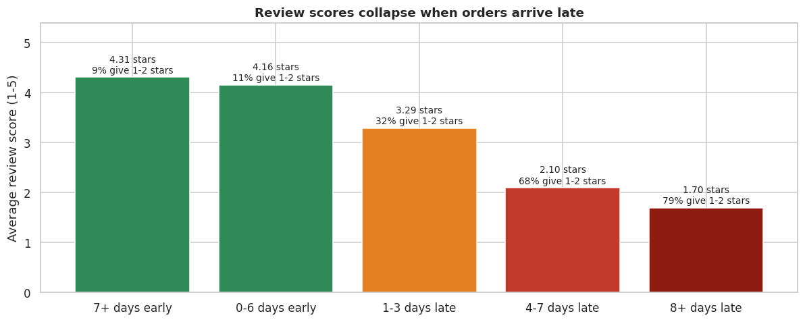
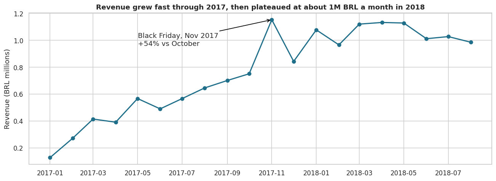
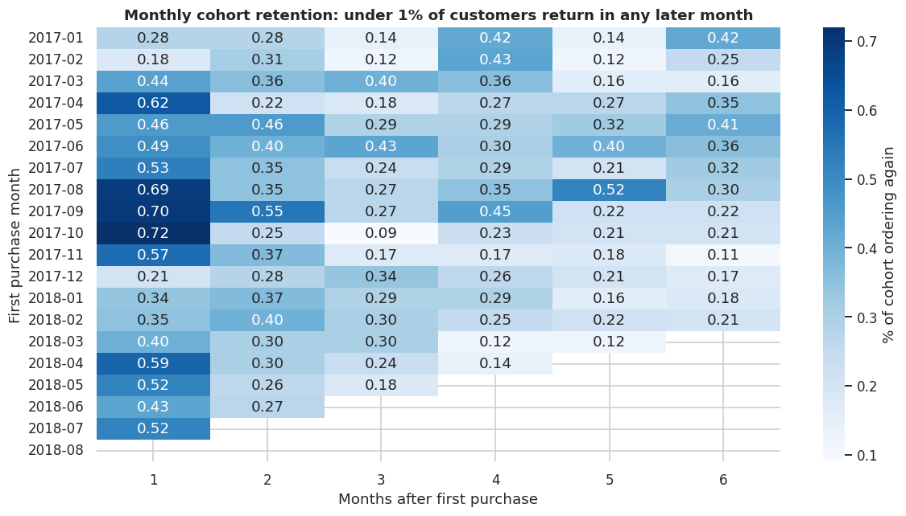
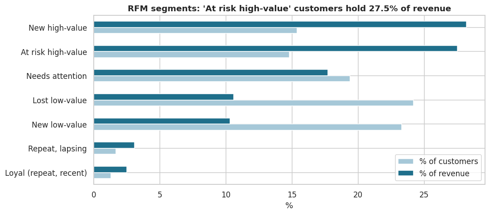
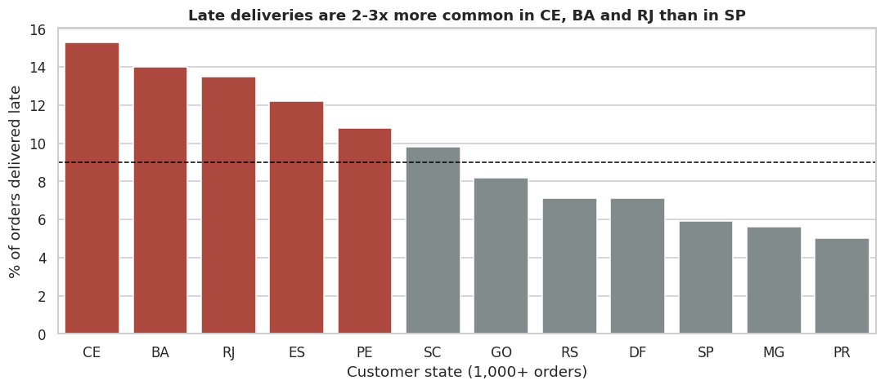

# Olist E-commerce Analysis: Growth, Retention and Delivery Experience

**Olist more than doubled revenue in 2018, but only 3% of customers ever ordered twice, and late deliveries were wrecking reviews.** This project uses SQL on 8 linked tables to find where revenue comes from, why growth stalled, and what the business should fix.

**[View the interactive dashboard](https://YOUR-GITHUB-USERNAME.github.io/olist-ecommerce-analysis/)**



## Business problem
Olist is a Brazilian online marketplace that connects small sellers to customers. After fast growth in 2017, monthly revenue flattened in 2018. The questions:
1. Where does revenue come from, and how is it trending?
2. Do customers come back?
3. Which customers are worth targeting?
4. What is hurting customer satisfaction?

## Key results
| Metric | Value |
| --- | --- |
| Delivered orders (Jan 2017 - Aug 2018) | 96,211 |
| Revenue | 15.4M BRL |
| Average order value | 159.8 BRL |
| Revenue growth, Jan-Aug 2018 vs 2017 | +143% |
| Customers who ever ordered twice | 3.0% |
| Avg review: early delivery vs 8+ days late | 4.3 vs 1.7 stars |

## Findings
1. **Growth stalled in 2018.** Revenue climbed through 2017, peaking on Black Friday (+54% vs October), then moved sideways at about 1M BRL a month. The plateau came from order volume, not basket size.
2. **Customers almost never return.** Only 3% place a second order, and fewer than 1% of any monthly cohort return in any of the next six months.
3. **One-time big spenders hold 27.5% of revenue.** RFM segmentation found about 13,800 high-value customers who bought once and haven't returned in over a year.
4. **Late delivery destroys reviews.** Orders 8+ days late average 1.7 stars, and 79% get a 1-2 star review.
5. **Late deliveries cluster by region.** CE, BA and RJ are late 13-15% of the time vs 5.9% in SP; RJ is the second-largest market.
6. **Revenue is diversified.** The top 10 categories make up 62% of revenue, and none exceeds 10%.







## Recommendations
1. **Make retention the top priority:** post-purchase emails, a second-order coupon and category-based recommendations.
2. **Run a win-back campaign** for the ~13,800 at-risk high-value customers.
3. **Fix delivery promises in CE, BA and RJ** by improving carriers or setting realistic delivery dates.
4. **Reach out proactively on late orders** with an apology or small voucher.
5. **Plan stock and marketing around Black Friday,** the strongest month.



## Approach
| Step | What I did | SQL techniques |
| --- | --- | --- |
| Data checks | Order statuses, missing delivery dates, duplicates, missing categories; found that `customer_id` changes per order, so customers are counted by `customer_unique_id` | GROUP BY, CASE WHEN, subqueries |
| Growth | Headline KPIs and monthly revenue with month-on-month growth | CTEs, DATE_TRUNC, LAG |
| Categories | Top 10 categories with share and running total | 4-table JOIN, LEFT JOIN, COALESCE, RANK, SUM OVER |
| Retention | Repeat rate and monthly cohort retention | Multi-step CTEs, DATE_DIFF, FIRST_VALUE |
| Segmentation | RFM adapted for mostly one-time buyers | NTILE, CASE WHEN rules |
| Satisfaction | Delivery delay vs review score; late rate by state | DATE_DIFF, conditional averages, HAVING |

## Tools
SQL (DuckDB), Python (pandas, Matplotlib, Seaborn), Jupyter, HTML/JavaScript (Chart.js) for the dashboard, GitHub Pages for hosting.

## Repository structure
```
olist-ecommerce-analysis/
├── data/                         Olist CSV files + data dictionary
├── sql/
│   ├── 00_load_tables.sql        loads the CSVs into DuckDB
│   └── 01_analysis_queries.sql   9 analysis queries
├── notebooks/
│   └── olist_ecommerce_analysis.ipynb   full analysis with charts and commentary
├── src/
│   └── run_analysis.py           runs every query end to end, saves results, refreshes the dashboard
├── outputs/                      query results as CSV (q1_kpis.csv ... q9_payment_methods.csv)
├── images/                       charts used in this README
└── docs/                         interactive dashboard (index.html + data.js), served by GitHub Pages
```

## How to run
```bash
git clone https://github.com/YOUR-GITHUB-USERNAME/olist-ecommerce-analysis.git
cd olist-ecommerce-analysis
pip install -r requirements.txt

python src/run_analysis.py          # runs all 9 queries, writes outputs/ and docs/data.js
jupyter notebook notebooks/olist_ecommerce_analysis.ipynb   # full walkthrough with charts
```
To view the dashboard locally, open `docs/index.html` in a browser.

The SQL is written for DuckDB. Most queries run in PostgreSQL unchanged; for MySQL, replace `DATE_TRUNC` and `DATE_DIFF` with `DATE_FORMAT` and `TIMESTAMPDIFF`.

## Limitations
- No website or cart events, so conversion funnels and cart abandonment can't be measured.
- Data ends in August 2018.
- The link between late delivery and lost repeat purchases is suggested by the data, not proven; a next step would compare repeat rates for customers whose first order was late vs on time.

## Data source
[Brazilian E-Commerce Public Dataset by Olist](https://www.kaggle.com/datasets/olistbr/brazilian-ecommerce) (Kaggle), CC BY-NC-SA 4.0.

## Author
**Pratiti Toppo**, B.Tech, NIT Jamshedpur. Data analyst with experience in e-commerce analytics (Eternz) and manufacturing quality data (AM/NS).
[LinkedIn](https://www.linkedin.com/in/YOUR-LINKEDIN) · pratititoppo6@gmail.com
